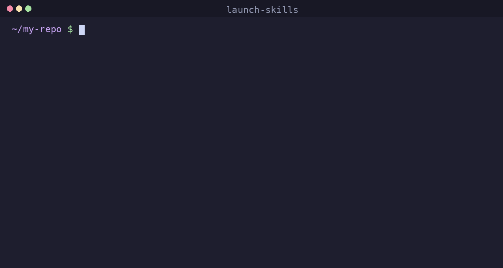

# launch-skills

Agent skills that launch your open-source repo: README, demo, Show HN, Reddit, Trending. Backed by data from 188,000 Show HN posts.



Works with Claude Code, Cursor, Codex, Copilot, OpenCode and any agent that reads `SKILL.md`.

## Install

```bash
npx skills add karix-ai/launch-skills
```

Then, inside your project:

```
> audit my repo for launch
> rewrite the README so it sells
> write my Show HN post and tell me when to submit
```

The agent loads the matching skill and does the work. Install one skill only with `--skill show-hn-launch`.

## Why

Most good repos get 10 stars. Not because the code is bad, but because the README starts with a paragraph of history, there is no demo, the Show HN goes up at 3 pm on a Friday with a title that says "blazing fast", and nobody answers the first comment.

The fixes are known. They are just spread across a hundred blog posts and a few people's heads. These skills put them in your agent so the right thing happens by default:

- The median Show HN scores **2 points**; a 50-point post is top 6%. The title and the hour are most of the difference.
- Each HN upvote ≈ **1.4 GitHub stars** within 48 h. ~92% of launch stars arrive in the first two days.
- Best posting slot: **Monday 00:00 UTC** (Sunday 7 pm Eastern). Second: Tue–Thu 8–10 am Eastern.
- GitHub Trending ranks **stars gained in a window**, not totals. 80 stars in one day beats 300 over a month.

Sources and the full numbers: [data/launch-stats.md](data/launch-stats.md).

## Skills

| Skill | What the agent does |
|---|---|
| `launch-audit` | Scores launch readiness 0–100, lists blockers. **Run this first.** |
| `readme-that-sells` | Rewrites the README to pass the 15-second test: pitch, demo, one-command install, honest "why". |
| `demo-gif` | Produces the demo GIF/MP4 (VHS tape for terminal tools) sized for README and social. |
| `repo-hygiene` | Description, topics, license, release, social preview, good-first-issues, all via `gh`. |
| `show-hn-launch` | Five scored titles, the first comment, the posting slot in your time zone. |
| `reddit-launch` | Picks 1–3 subreddits, checks their rules, writes a post for each. |
| `launch-plan` | The 7-day schedule that concentrates everything into one day to hit Trending. |
| `launch-day-ops` | The reply loop, triage, hot-fix release, how to answer "why not just use X". |
| `awesome-list-pr` | Finds the lists you belong on and writes PRs in each list's exact format. |
| `second-wave` | The follow-up piece 4–7 days later: deep-dive, benchmark, "we're trending" post. |

## Example

```
> write my Show HN post

Title (score 7/7): Show HN: Lightpanda – headless browser for AI agents, 10x less RAM than Chrome
Runner-ups: …

First comment:
Hi HN, I'm …
<limitation line> It doesn't run JavaScript-heavy SPAs yet; that's the next milestone.

Post at: Mon 2026-11-09 00:00 UTC = Sun 2026-11-08 19:00 America/New_York = Mon 01:00 Europe/Berlin
Checklist: submit → first comment within 60 s → share the HN link (not the repo) → reply loop for 3 h
```

## What it is not

It does not buy stars, run vote rings, or post for you. It writes, schedules, checks and tells you what to do; you press the buttons. Projects that fake traction get removed from both GitHub and HN, and the skills say so.

## Contributing

Each skill is a folder under `skills/` with a `SKILL.md`. Improvements to the numbers (with a source), new channels, and per-ecosystem subreddit maps are welcome. See [CONTRIBUTING.md](CONTRIBUTING.md).

## License

MIT
